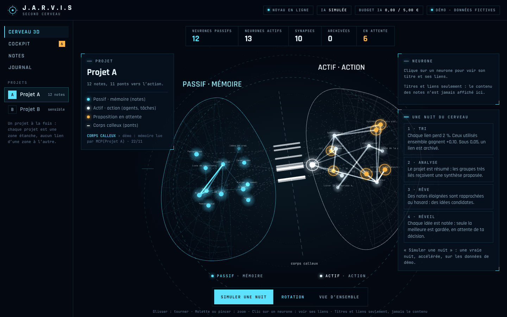

# JARVIS

JARVIS est un **second cerveau** personnel, inspiré de JARVIS dans Iron Man. Il garde la mémoire
de chacun de tes projets, la fait vivre (les liens utiles se renforcent, les autres s'oublient),
rêve la nuit pour te proposer des idées, et fait travailler des agents qui **proposent** sans
jamais rien écrire seuls : c'est toi qui valides.

> **État : prototype fonctionnel n°1.** Tout tourne sur ton Mac, en Python seul (**rien à
> installer**), avec une IA **simulée** par défaut : 0 €, aucune clé, aucun réseau nécessaire.
> 184 tests automatiques, tous réussis.



## Les mots à connaître

| Mot | Ce que c'est |
|---|---|
| **Projet** | Un dossier étanche : ses notes, sa base, son journal. Aucun lien entre deux projets. |
| **Neurone** | Une note (fichier texte Markdown). Le contenu ne s'affiche jamais dans le cerveau 3D. |
| **Synapse** | Un lien `[[Titre]]` entre deux notes, avec un poids de 0 à 1. Il monte de 0,10 quand les notes servent ensemble (si elles sont validées), baisse de 2 % chaque nuit, et s'archive sous 0,05. |
| **Hémisphère passif** | La mémoire : notes, synapses, journal, sommeil. |
| **Hémisphère actif** | L'action : orchestrateur, agents, routeur IA, modules. |
| **Corps calleux** | Le seul pont entre les deux. C'est un **serveur MCP** : le standard qui permet à Claude (Desktop ou Code) d'utiliser des outils. 4 messages : `se_souvenir`, `proposer`, `activer`, `journal`. |
| **Garde d'écriture** | Un agent ne fait que **proposer**, sur une copie. Rien n'est écrit sans ta validation : bouton Valider, ou `python3 -m noyau.valider`. |
| **Agents · 4 voies** | Planifier (tâches et ordres), Proposer (notes), Comparer (notes proches), Vérifier (propositions et liens cassés). |
| **Routeur IA** | La seule porte vers l'IA : modèle local (Ollama) d'abord, Gemini gratuit pour le non sensible, Claude payant plafonné à 5 €/mois. Mode **simulé** par défaut. |
| **Sommeil et rêve** | Une fois par jour et par projet : tri, analyse, rêve (des idées en croisant des notes éloignées), réveil (seule la meilleure idée est gardée). |

## Essayer la démo sur ton Mac, pas à pas

La démo utilise de **fausses données** (« Projet A » et « Projet B ») rangées à part, dans
`~/.jarvis/demo/` : elle ne touche jamais à tes vrais projets.

1. **Télécharger JARVIS.** Ouvre la page de la branche sur GitHub, clique sur le bouton vert
   **Code**, puis **Download ZIP**. Ouvre le fichier : un dossier `JARVIS-…` apparaît dans
   **Téléchargements**.
2. **Ouvrir le Terminal.** **Cmd + Espace**, tape `Terminal`, puis **Entrée**.
3. **Aller dans le dossier.** Tape `cd ` (avec l'espace), **glisse le dossier** `JARVIS-…` depuis
   le Finder dans la fenêtre du Terminal, puis **Entrée**.
4. **Vérifier Python.** Tape `python3 --version` puis **Entrée** : tu dois voir `Python 3.9` ou
   plus. Si le Mac propose d'installer les « outils de développement », accepte et recommence.
5. **Lancer la démo** :

   ```
   python3 exemples/demo.py
   ```

   Le Terminal raconte chaque étape :
   1. Mémoire : deux projets, notes liées et validées ;
   2. Nuit de sommeil : propositions de tri, synthèse, idée rêvée ;
   3. Orchestrateur : les 4 voies d'agents font leurs propositions ;
   4. Garde d'écriture : une proposition validée par la commande `python3 -m noyau.valider` ;
   5. Corps calleux : la mémoire lue par un vrai client MCP, comme le ferait Claude ;
   6. Interface : ton navigateur s'ouvre sur le **cerveau 3D**. Laisse le Terminal ouvert.
6. **À essayer dans le navigateur :**
   - **Cerveau 3D** : glisse pour tourner, clique sur un neurone pour voir ses liens et leur poids ;
     **Simuler une nuit** déroule une vraie nuit (tri, analyse, rêve, réveil) ; onglets Projet A / B.
   - **Cockpit** : l'ordre du moment (Fait / Pas fait), les propositions à **Valider** ou
     **Refuser**, les 4 voies d'agents, le journal qui se met à jour tout seul, l'idée du jour.
   - **Notes** : lire, écrire, relier avec `[[Titre]]`.
   - **Version iPhone** : rétrécis la fenêtre ; le graphe passe en haut, les panneaux en liste dessous.
7. **Arrêter** : **Ctrl + C** dans le Terminal. Repartir d'une démo neuve :
   `python3 exemples/demo.py --remplacer`.

Sans Internet, tout marche sauf le cerveau en 3D (sa bibliothèque Three.js vient d'Internet) et
les polices : l'aperçu 2D du cockpit le remplace.

## Avec tes vrais projets

| Pour… | Commande (dans le dossier JARVIS) |
|---|---|
| Ouvrir l'interface sur tes données (`~/.jarvis/`) | `python3 jarvis.py cockpit` |
| Voir les propositions en attente | `python3 -m noyau.valider` |
| Valider (ou refuser) une proposition | `python3 -m noyau.valider "Projet:3"` (`--refuser "raison"`) |
| Lancer un tour de l'orchestrateur | `python3 jarvis.py tour` |
| Faire dormir et rêver un projet (1 fois / 24 h) | `python3 jarvis.py dormir "Projet"` |
| L'idée du jour, la garder ou la rejeter | `python3 jarvis.py reve` · `python3 jarvis.py reve garder "Projet:1" "raison"` |
| Rêver à chaque réveil du Mac | `python3 jarvis.py installer-sommeil` |
| Brancher Claude Desktop (MCP) | `python3 jarvis.py config-claude`, coller le réglage affiché, redémarrer Claude |
| Lancer le serveur MCP à la main | `python3 -m noyau.corps_calleux` |
| Activer le module de notifications | `python3 jarvis.py modules --activer notifications` |
| Lancer tous les tests | `python3 jarvis.py tests` |

Toutes les commandes : `python3 jarvis.py --help`. Pour essayer sur un autre dossier de données :
`python3 jarvis.py --dossier /un/dossier …`.

## Démo en ligne (Vercel)

Le dossier `vercel-demo/` est une **version de démonstration** de l'interface, faite de simples
fichiers (HTML, JavaScript, JSON), qu'on peut publier telle quelle sur Vercel (un hébergeur de
sites) : aucun serveur Python, aucune clé, aucune donnée réelle.

- **Ce qu'elle montre** : les deux projets fictifs de la démo (cerveau 3D, cockpit, notes, journal),
  avec leurs titres, liens, poids, propositions et journal. Jamais le texte des notes.
- **Ce qu'on peut y faire** : « Simuler une nuit » (oubli 0,02, apprentissage 0,10, archivage sous
  0,05, calculés dans le navigateur, avec exactement les mêmes résultats que le vrai JARVIS),
  valider ou refuser une proposition, Fait / Pas fait, garder ou rejeter l'idée du jour. Un bandeau
  le rappelle : « Démo en ligne : données fictives, rien n'est enregistré ». Tout revient à zéro
  quand on recharge la page.

**Refaire l'export** (après un changement de l'interface ou de la démo), dans le dossier JARVIS :

```
python3 exemples/export_demo.py
```

Le script fait tourner la démo dans un dossier temporaire (jamais `~/.jarvis`), puis écrit
`vercel-demo/data/*.json` et `vercel-demo/index.html`. Un test (`interface/test_demo_en_ligne.py`)
vérifie qu'aucun chemin local, aucune clé et aucun texte de note n'y figure.

**La voir sur ton Mac avant de la publier** :

```
python3 -m http.server 8000 --directory vercel-demo
```

puis ouvre http://localhost:8000 dans ton navigateur (**Ctrl + C** pour arrêter).

**La publier sur Vercel** : sur vercel.com, « Add New… › Project », importe le dépôt GitHub, choisis
la branche `vercel-demo`, et laisse les réglages par défaut : le fichier `vercel.json` (à la racine)
dit déjà à Vercel de servir le dossier `vercel-demo/` sans rien construire.

**La limite** : c'est une démo, **pas le vrai JARVIS**. Pas de mémoire qui se garde, pas de
corps calleux (MCP), pas d'agents qui tournent, pas d'IA, pas de sommeil complet (seules les
synapses sont recalculées). Ne mets jamais de vraies données dans ce dossier : il est public.

## Réglages : `~/.jarvis/reglages.local`

Ce fichier est créé tout seul à la première commande, **hors du dépôt**. Les principaux :

| Réglage | Par défaut | Rôle |
|---|---|---|
| `mode_ia` | `simule` | `simule` = IA factice sans réseau ; `reel` = vraies IA |
| `BUDGET_IA_MAX_EUR_MOIS` | `5` | plafond de dépense IA par mois : au-delà, l'appel est bloqué |
| `modele_local` | `aucun` | nom du modèle Ollama (ex. `llama3.2`), quand Ollama sera installé |
| `CLE_API_GEMINI`, `CLE_API_ANTHROPIC` | vides | tes clés, à écrire **toi-même** dans ce fichier, jamais dans le chat |
| `idees_par_projet`, `candidates_par_nuit` | `1`, `5` | idées gardées et imaginées chaque nuit |
| `cloud_pour_reveil` | `false` | permet le cloud payant pour noter les idées (réveil) |
| `contrainte_budget_eur`, `contrainte_niveau`, `contrainte_objectifs` | `0`, `débutant`, vide | tes contraintes, pour noter les idées du rêve |

`reglages.exemple` (dans le dépôt) montre tous les réglages possibles, sans aucune vraie valeur.

## Structure du dépôt

| Dossier ou fichier | Rôle |
|---|---|
| `noyau/projets.py` | Projets étanches, notes Markdown, liens, recherche plein texte (FTS5), journal |
| `noyau/synapses.py` | Synapses : création, renforcement, oubli, archivage |
| `noyau/corps_calleux.py` | Les 4 messages + les actions humaines ; `python3 -m noyau.corps_calleux` lance le serveur MCP |
| `noyau/serveur_mcp.py`, `noyau/client_mcp.py` | Le protocole MCP (serveur et petit client de test) |
| `noyau/routeur.py`, `noyau/routeur_ia.py` | Le routeur IA, le budget, les vrais branchements (Ollama, Gemini, Claude) |
| `noyau/orchestrateur.py`, `noyau/agents.py`, `noyau/voies.py`, `noyau/agents/` | Hémisphère actif : la boucle, les agents (un fichier de réglage chacun), les 4 voies |
| `noyau/valider.py` | La garde d'écriture humaine : `python3 -m noyau.valider` |
| `noyau/sommeil.py`, `noyau/reve.py`, `noyau/ia_demo.py` | Sommeil (tri, analyse) et rêve (rêve, réveil) ; l'IA simulée |
| `noyau/modules.py`, `modules/notifications/` | La prise standard des modules et le premier module |
| `interface/` | Le serveur web local (127.0.0.1 seulement) et la page : cerveau 3D, cockpit, notes, journal |
| `exemples/demo.py` | La démo de bout en bout |
| `exemples/export_demo.py`, `vercel-demo/`, `vercel.json` | La démo en ligne : export, site statique, réglage Vercel |
| `jarvis.py` | La « télécommande » : toutes les commandes |
| `docs/maquettes/` | Captures de l'interface (données fictives) |
| `RAPPORT-FINAL.md` | Ce qui a été construit, testé, et ce qui reste à décider |

Le **noyau** est générique : rien n'y est propre à un domaine (crypto, agenda, sport…). Tout ce
qui est particulier devient un module dans `modules/`.

## Maquettes

- Dans le dépôt : [cerveau 3D](docs/maquettes/cerveau-3d.png) · [cockpit](docs/maquettes/cockpit.png) ·
  [iPhone, cerveau](docs/maquettes/iphone-cerveau.png) · [iPhone, cockpit](docs/maquettes/iphone-cockpit.png)
- Maquettes de référence (privées, sur ton compte claude.ai) :
  [cerveau 3D](https://claude.ai/artifact/KeQgGmVcuthtFE3QT6oxmc) ·
  [cockpit Mac et iPhone](https://claude.ai/artifact/DkTEuJwajiCwFuZM3fv83d)
- Direction visuelle : fond `#030811`, cyan `#5CE1FF` dominant, blanc `#E6F7FF`, gris-bleu `#86A9BC`,
  ambre `#FFB547` réservé à ce qui demande une action ; titres en Rajdhani, données en JetBrains Mono.

## Règle d'or : aucun secret dans ce dépôt

Ce dépôt est **public**. Aucune clé API, aucun mot de passe, aucun jeton ne doit y être écrit,
ni dans le chat. Tes clés vont dans `~/.jarvis/reglages.local`, dans ton dossier personnel, hors
du dépôt. Tes données (notes, bases, journal) vivent dans `~/.jarvis/`, jamais dans le dépôt.
Les notes **sensibles** ne partent jamais vers une offre d'IA gratuite, et leur texte est masqué
quand Claude interroge le cerveau.
