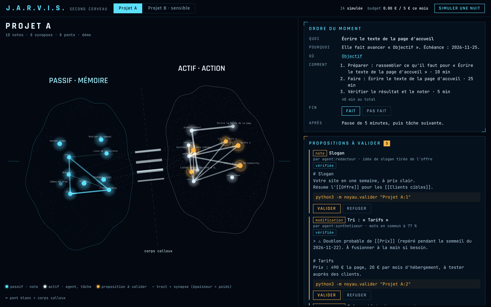

# JARVIS

JARVIS est un assistant personnel modulaire, pensé comme un second cerveau.
Il repose sur un **noyau** générique (le moteur commun) auquel on branche des **modules** (une fonction précise chacun).
Le noyau ne contient rien de spécifique à un domaine : tout ce qui est particulier va dans un module.

> **État : prototype fonctionnel n°1.** Toutes les briques tournent, avec une IA **simulée** par
> défaut (gratuite, locale, sans clé). Python seul : **rien à installer**.



## Comment c'est construit

```
INTERFACE        cockpit web local · éditeur de notes · cerveau 3D
HÉMISPHÈRE ACTIF                         HÉMISPHÈRE PASSIF
 orchestrateur (observer, décider,        notes Markdown = neurones
   agir, mesurer)                         synapses (liens pondérés)
 agents en 4 voies                        base SQLite par projet
 routeur IA (plafond 5 €/mois)            journal
 garde d'écriture · modules               sommeil (oubli + synthèse)
            \                                  /
             ===== CORPS CALLEUX (MCP) =====
              se_souvenir · proposer · activer · journal
```

- **Projets étanches** : un projet = un dossier = ses notes, sa base, son journal. Aucun accès entre projets.
- **Synapses** : chaque lien `[[Titre]]` relie deux notes. Le lien se renforce quand les notes servent
  ensemble, et s'affaiblit chaque nuit (oubli). Seules les notes validées renforcent des liens.
- **Garde d'écriture** : un agent ne fait que **proposer**. Rien n'est écrit avant ta validation.
  Aucun agent ne peut publier, payer ou supprimer.

## Essayer la démo sur ton Mac, pas à pas

La démo utilise de **fausses données** (« Projet A » et « Projet B ») rangées à part, dans
`~/.jarvis/demo/` : elle ne touche jamais à tes vrais projets. L'IA est simulée : 0 €.

1. **Télécharger JARVIS.** Sur la page GitHub du dépôt, choisis la branche voulue, clique sur
   le bouton vert **Code**, puis **Download ZIP**. Ouvre le fichier téléchargé : un dossier
   `JARVIS-…` apparaît dans **Téléchargements**.
2. **Ouvrir le Terminal.** Appuie sur **Cmd + Espace**, tape `Terminal`, puis **Entrée**.
3. **Aller dans le dossier.** Tape `cd ` (avec l'espace), glisse le dossier `JARVIS-…` depuis le
   Finder dans la fenêtre du Terminal, puis appuie sur **Entrée**.
4. **Vérifier Python.** Tape `python3 --version` puis **Entrée**. Tu dois voir `Python 3.9` ou
   plus. Si le Mac propose d'installer les « outils de développement », accepte et recommence.
5. **Lancer la démo.** Tape :

   ```
   python3 exemples/demo.py
   ```

   Le Terminal affiche « Démo créée… » puis « Cockpit JARVIS prêt », et ton navigateur s'ouvre
   sur le cerveau 3D. **Laisse le Terminal ouvert** pendant que tu utilises l'interface.
6. **Ce que tu peux essayer :**
   - les onglets **Projet A / Projet B** (un projet à la fois) ;
   - glisser sur le cerveau pour le tourner, cliquer sur un neurone pour voir ses liens ;
   - **Simuler une nuit** : oubli 0,02, apprentissage 0,10, archivage sous 0,05 ;
   - **Ordre du moment** : Fait / Pas fait ;
   - **Propositions à valider** : bouton Valider, ou dans un **second** Terminal (même dossier) :
     `python3 -m noyau.valider --dossier ~/.jarvis/demo "Projet A:1"`.
7. **Arrêter.** Dans le Terminal, appuie sur **Ctrl + C**. Pour repartir d'une démo neuve :
   `python3 exemples/demo.py --remplacer`.

**Maquettes** (captures de la démo) : [ordinateur](docs/maquettes/cockpit-ordinateur.png) ·
[projet sensible](docs/maquettes/cockpit-projet-sensible.png) · [iPhone](docs/maquettes/cockpit-iphone.png).
Elles suivent le document du projet « JARVIS - design interface (direction visuelle) » :
fond `#030811`, cyan `#5CE1FF` dominant, blanc `#E6F7FF`, gris-bleu `#86A9BC`, ambre `#FFB547`
réservé à ce qui demande une action ; titres en Rajdhani, données en JetBrains Mono.

Sur iPhone : la mise en page est prête (graphe en haut, panneaux en liste dessous), mais pour
l'instant l'interface n'est ouverte qu'au Mac lui-même (127.0.0.1), par sécurité. L'accès depuis
l'iPhone viendra avec le serveur (marche 8). En attendant, rétrécis la fenêtre du navigateur
sur le Mac pour voir la version iPhone.

## Avec tes vrais projets

- Ouvrir le cockpit sur tes données (`~/.jarvis/`) : `python3 jarvis.py cockpit`
- Brancher Claude Desktop : `python3 jarvis.py config-claude` affiche le réglage à coller.
- Valider une proposition : `python3 -m noyau.valider` (liste), puis `python3 -m noyau.valider "Projet:numéro"`.
- Lancer le rêve à chaque réveil du Mac : `python3 jarvis.py installer-sommeil`.
- Passer aux vraies IA : dans `~/.jarvis/reglages.local`, mets `mode_ia=reel`, puis ta clé
  `CLE_API_GEMINI=` (gratuit, pour le courant non sensible) et/ou `CLE_API_ANTHROPIC=` (payant,
  plafonné à 5 € par mois), et/ou `modele_local=` (Ollama). Jamais de clé dans le chat ni le dépôt.

Toutes les commandes : `python3 jarvis.py --help`.

## Sommeil et rêve

`python3 jarvis.py dormir` (tous les projets) ou `python3 jarvis.py dormir Demo-A` (un seul).
Règle des 24 h : un projet qui a déjà rêvé dans les dernières 24 heures est laissé tranquille.
C'est une commande autonome : aujourd'hui, `python3 jarvis.py installer-sommeil` la fait lancer
par le Mac à chaque réveil et à l'ouverture de session ; demain, un mode nuit ou un serveur
pourra l'appeler de la même façon. Rien ne touche à la veille du Mac.

Chaque projet rêve seul (étanchéité conservée), en 4 phases, chacune notée au journal :

| Phase | Ce qui se passe |
|---|---|
| Tri | Le code applique l'oubli et archive les liens trop faibles. Puis l'IA repère doublons, notes orphelines et notes périmées : chaque correction devient une **proposition** à valider. |
| Analyse | Résumé du projet entier (code puis IA, au plus `tokens_max_analyse` jetons envoyés) et synthèses proposées pour les groupes de notes très liées. |
| Rêve | Des paires ou triplets de notes **éloignées** sont tirés au hasard ; une IA créative (température haute) imagine `candidates_par_nuit` idées. |
| Réveil | Une IA rigoureuse note chaque idée (nouveauté, utilité, faisabilité selon tes contraintes) et ne garde que **la meilleure** (`idees_par_projet`, 1 par défaut). |

L'idée du jour : `python3 jarvis.py reve`. Ta décision :
`python3 jarvis.py reve garder Demo-A:1 "raison"` ou `python3 jarvis.py reve rejeter Demo-A:1 "raison"`.
Une idée gardée renforce les liens entre ses notes sources ; la raison d'un rejet est rappelée
au rêve suivant pour ne pas la répéter. Le rêve ne fait que proposer : il n'agit jamais.

**Quelle IA ?**
- Le modèle local (Ollama, gratuit, sur ton Mac) d'abord, s'il est installé et renseigné
  (`modele_local`). Lui seul peut recevoir des notes sensibles.
- Sans modèle local : les notes sensibles sont exclues du rêve ; les autres peuvent passer par
  l'offre gratuite autorisée par le routeur.
- Cloud payant : seulement pour la phase réveil, si `cloud_pour_reveil=true`, dans la limite
  du budget IA mensuel du routeur. Jamais de note sensible vers une offre gratuite.

**Réglages** : `~/.jarvis/reglages.local` (hors du dépôt), créé tout seul avec les valeurs par
défaut à la première commande. Tu y mets aussi tes contraintes : `contrainte_budget_eur`,
`contrainte_niveau`, `contrainte_objectifs`.

Sans clé API ni Ollama, tout tourne en mode démo (IA de démonstration, 0 €) :
`python3 exemples/demo.py`, puis `python3 jarvis.py --dossier ~/.jarvis/demo reve`.

## Structure des dossiers

| Dossier | Rôle |
|---|---|
| `noyau/` | Le moteur commun : projets, synapses, corps calleux, serveur MCP, routeur IA, orchestrateur, agents, sommeil et rêve, prises pour modules. |
| `noyau/agents/` | Un fichier par agent : sa consigne et les seuls outils autorisés. |
| `modules/` | Les modules branchables. Exemple : `notifications` (mode DÉMO). Retirer un dossier retire le module. |
| `interface/` | Le cockpit web (serveur local + page avec le cerveau 3D). |
| `exemples/` | Les projets de démonstration. |
| `jarvis.py` | La commande principale (la « télécommande »). |

Fichiers à la racine : `.gitignore` (ce que Git ne doit jamais envoyer), `reglages.exemple`
(modèle de réglages sans aucune vraie valeur ; les vrais réglages vivent dans `~/.jarvis/reglages.local`).

Tes données vont dans `~/.jarvis/` (jamais dans le dépôt) :
`projets/<nom>/notes/*.md`, `projets/<nom>/projet.db`, `systeme.db` (budget IA, modules).

## Tests

`python3 jarvis.py tests` lance tous les tests. Ils travaillent dans un dossier temporaire
et ne touchent jamais à `~/.jarvis`.

## Règle d'or : aucun secret dans ce dépôt

Ce dépôt est **public**. Aucune clé API, aucun mot de passe, aucun jeton ne doit y être écrit.

Pour configurer JARVIS : ouvre `~/.jarvis/reglages.local` (créé automatiquement à la première
commande) et mets-y tes vraies valeurs. Ce fichier est dans ton dossier personnel, hors du dépôt :
il n'est jamais envoyé sur GitHub. `reglages.exemple` montre les réglages possibles.

Les notes **sensibles** (ou d'un projet sensible) ne partent jamais vers une IA gratuite en ligne,
et leur texte est masqué quand Claude interroge le cerveau via MCP.
