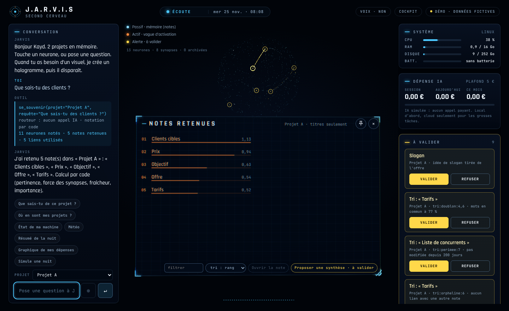

# JARVIS

JARVIS est un **second cerveau** personnel, inspiré de JARVIS dans Iron Man. Il garde la mémoire
de chacun de tes projets, la fait vivre (les liens utiles se renforcent, les autres s'oublient),
rêve la nuit pour te proposer des idées, et fait travailler des agents qui **proposent** sans
jamais rien écrire seuls : c'est toi qui valides.

> **État : prototype fonctionnel n°1.** Tout tourne sur ton Mac, en Python seul (**rien à
> installer**), avec une IA **simulée** par défaut : 0 €, aucune clé, aucun réseau nécessaire.
> 184 tests automatiques, tous réussis.



## Les mots à connaître

| Mot | Ce que c'est |
|---|---|
| **Projet** | Un dossier étanche : ses notes, sa base, son journal. Aucun lien entre deux projets. |
| **Neurone** | Une note (fichier texte Markdown). Le contenu ne s'affiche jamais dans la sphère. |
| **Synapse** | Un lien `[[Titre]]` entre deux notes, avec un poids de 0 à 1. Il monte de 0,10 quand les notes servent ensemble (si elles sont validées), baisse de 2 % chaque nuit, et s'archive sous 0,05. |
| **Hémisphère passif** | La mémoire : notes, synapses, journal, sommeil. |
| **Hémisphère actif** | L'action : orchestrateur, agents, routeur IA, modules. |
| **Corps calleux** | Le seul pont entre les deux. C'est un **serveur MCP** : le standard qui permet à Claude (Desktop ou Code) d'utiliser des outils. 4 messages : `se_souvenir`, `proposer`, `activer`, `journal`. |
| **Garde d'écriture** | Un agent ne fait que **proposer**, sur une copie. Rien n'est écrit sans ta validation : bouton Valider, ou `python3 -m noyau.valider`. |
| **Agents · 4 voies** | Planifier (tâches et ordres), Proposer (notes), Comparer (notes proches), Vérifier (propositions et liens cassés). |
| **Routeur IA** | La seule porte vers l'IA : modèle local (Ollama) d'abord, Gemini gratuit pour le non sensible, Claude payant plafonné à 5 €/mois. Mode **simulé** par défaut. |
| **Sommeil et rêve** | Une fois par jour et par projet : tri, analyse, rêve (des idées en croisant des notes éloignées), réveil (seule la meilleure idée est gardée). |

## Essayer la démo sur ton Mac, pas à pas

La démo utilise de **fausses données** (« Projet A » et « Projet B ») rangées à part, dans
`~/.jarvis/demo/` : elle ne touche jamais à tes vrais projets.

1. **Télécharger JARVIS.** Ouvre la page de la branche sur GitHub, clique sur le bouton vert
   **Code**, puis **Download ZIP**. Ouvre le fichier : un dossier `JARVIS-…` apparaît dans
   **Téléchargements**.
2. **Ouvrir le Terminal.** **Cmd + Espace**, tape `Terminal`, puis **Entrée**.
3. **Aller dans le dossier.** Tape `cd ` (avec l'espace), **glisse le dossier** `JARVIS-…` depuis
   le Finder dans la fenêtre du Terminal, puis **Entrée**.
4. **Vérifier Python.** Tape `python3 --version` puis **Entrée** : tu dois voir `Python 3.9` ou
   plus. Si le Mac propose d'installer les « outils de développement », accepte et recommence.
5. **Lancer la démo** :

   ```
   python3 exemples/demo.py
   ```

   Le Terminal raconte chaque étape :
   1. Mémoire : deux projets, notes liées et validées ;
   2. Nuit de sommeil : propositions de tri, synthèse, idée rêvée ;
   3. Orchestrateur : les 4 voies d'agents font leurs propositions ;
   4. Garde d'écriture : une proposition validée par la commande `python3 -m noyau.valider` ;
   5. Corps calleux : la mémoire lue par un vrai client MCP, comme le ferait Claude ;
   6. Cockpit : ton navigateur s'ouvre sur la **sphère** (voir « Le cockpit » plus bas).
      Laisse le Terminal ouvert.
6. **À essayer dans le navigateur :**
   - **Sphère** : pose une question (« Que sais-tu de ce projet ? »), regarde la vague orange,
     puis l'hologramme des notes retenues ; « État de ma machine », « Graphique de mes dépenses »,
     « Simule une nuit » ; **Valider** / **Refuser** dans la colonne de droite.
   - **Notes** : « ouvre la note Offre » ouvre l'éditeur local ; relie tes notes avec `[[Titre]]`.
   - **Version iPhone** : rétrécis la fenêtre ; la sphère passe en haut, la conversation et les
     widgets en liste dessous.
7. **Arrêter** : **Ctrl + C** dans le Terminal. Repartir d'une démo neuve :
   `python3 exemples/demo.py --remplacer`.

Sans Internet, tout marche sauf la 3D (sa bibliothèque Three.js vient d'Internet) et les
polices : l'interface affiche alors la liste de tes notes (titres seulement).

## Avec tes vrais projets

| Pour… | Commande (dans le dossier JARVIS) |
|---|---|
| Ouvrir le cockpit sur tes données (`~/.jarvis/`) | `python3 jarvis.py cockpit` |
| Voir les propositions en attente | `python3 -m noyau.valider` |
| Valider (ou refuser) une proposition | `python3 -m noyau.valider "Projet:3"` (`--refuser "raison"`) |
| Lancer un tour de l'orchestrateur | `python3 jarvis.py tour` |
| Faire dormir et rêver un projet (1 fois / 24 h) | `python3 jarvis.py dormir "Projet"` |
| L'idée du jour, la garder ou la rejeter | `python3 jarvis.py reve` · `python3 jarvis.py reve garder "Projet:1" "raison"` |
| Rêver à chaque réveil du Mac | `python3 jarvis.py installer-sommeil` |
| Brancher Claude Desktop (MCP) | `python3 jarvis.py config-claude`, coller le réglage affiché, redémarrer Claude |
| Lancer le serveur MCP à la main | `python3 -m noyau.corps_calleux` |
| Activer le module de notifications | `python3 jarvis.py modules --activer notifications` |
| Lancer tous les tests | `python3 jarvis.py tests` |

Toutes les commandes : `python3 jarvis.py --help`. Pour essayer sur un autre dossier de données :
`python3 jarvis.py --dossier /un/dossier …`.

## Le cockpit (marche 7)

`python3 jarvis.py cockpit` ouvre le cockpit dans ton navigateur (adresse locale
`127.0.0.1`, protégée par un jeton). Au centre, **une seule sphère** : un neurone par note, une
synapse par lien pondéré, une région par projet (jamais de synapse entre deux projets).

- **Couleurs** : bleu = mémoire au repos ; **orange** = JARVIS cherche (vague d'activation) ;
  **jaune** = une proposition attend ta validation (deux anneaux sur les notes concernées).
- **Gestes** : glisser pour tourner (avec élan), molette ou pincement pour zoomer, flèches et
  `+` / `-` au clavier ; survoler ou cliquer un neurone affiche son titre, son projet et ses liens.
- **Une question** (colonne de gauche) déclenche la **vague en 4 temps** (environ 10 s) :
  1 notation de tous les neurones (par code, sans IA), 2 propagation le long des synapses,
  3 sélection (les notes gardées, numérotées, face à toi), 4 réponse. La ligne « OUTIL » montre
  l'appel exact, par exemple `se_souvenir(projet="Projet A", requête="…")` et
  « routeur : aucun appel IA ». Seuls des identifiants, des titres et des scores voyagent : jamais
  le texte des notes.
- **Les hologrammes** n'apparaissent qu'à la demande : notes retenues, graphique des dépenses,
  machine, météo, résumé de la nuit, note sensible refusée. Tu peux les **déplacer**, les
  **redimensionner**, les **épingler** (ils ne se ferment plus tout seuls), tourner leur objet 3D,
  changer la **période**, **trier**, **filtrer** ; **Échap** ou **×** les ferme. Cliquer une
  note retenue l'allume sur la sphère ; « Ouvrir la note » ouvre l'éditeur local (jamais pour
  une note sensible).
- **Garde d'écriture** : un bouton marqué « · à valider » n'exécute rien. Il crée une
  proposition qui apparaît dans **À valider** ; seule ta validation écrit dans la mémoire.
- **Colonne de droite** : Système (CPU, RAM, disque, batterie, sans droits administrateur),
  Dépense IA (session, aujourd'hui, ce mois, plafond), À valider, Journal du jour (projets
  sensibles masqués).
- **Météo** (facultative) : renseigne `METEO_LATITUDE` et `METEO_LONGITUDE` dans
  `~/.jarvis/reglages.local`. Sinon, l'hologramme l'indique simplement.
- **Mode démo** : `?demo=1` à la fin de l'adresse affiche une démo fictive (220 neurones, badge
  « Démo · données fictives ») sans toucher à tes données. Le **catalogue**
  (`/sphere/catalogue.html`) montre chaque hologramme avec de fausses données.
- **iPhone** : la sphère en haut, la conversation dessous, puis les widgets en liste.
- Navigateur : Chrome ou Safari récent, avec WebGL. Sans WebGL, un message clair et la liste de
  tes notes (titres) s'affichent à la place de la sphère.

Tests : `python3 jarvis.py tests` lance aussi les tests JavaScript (si Node.js est installé).
Le test complet dans un navigateur (environ 2 minutes) se lance à part :
`JARVIS_E2E=1 python3 -m unittest interface.test_e2e_sphere` (Node.js et Playwright requis).

## Démo en ligne (Vercel)

Le dossier `vercel-demo/` est une **version de démonstration** de l'interface, faite de simples
fichiers (HTML, JavaScript, JSON), qu'on peut publier telle quelle sur Vercel (un hébergeur de
sites) : aucun serveur Python, aucune clé, aucune donnée réelle.

- **Le cockpit en mode démo** : 220 neurones fictifs calculés dans le navigateur, la vague en
  4 temps, les hologrammes, la planification, « Simule une nuit » (oubli 2 %, apprentissage +0,10,
  archivage sous 0,05), la garde d'écriture. Le badge « Démo · données fictives » le rappelle :
  rien n'est enregistré, tout revient à zéro quand on recharge la page.
- Le **catalogue** des hologrammes est à `/sphere/catalogue.html`.

**Refaire l'export** (après un changement de l'interface ou de la démo), dans le dossier JARVIS :

```
python3 exemples/export_demo.py
```

Le script copie le cockpit (`interface/sphere/`) dans `vercel-demo/index.html` et
`vercel-demo/sphere/`, en mode « démo en ligne ». Un test (`interface/test_demo_en_ligne.py`)
vérifie que le site est à jour et qu'aucune clé ni aucun chemin local n'y figure.

**La voir sur ton Mac avant de la publier** :

```
python3 -m http.server 8000 --directory vercel-demo
```

puis ouvre http://localhost:8000 dans ton navigateur (**Ctrl + C** pour arrêter).

**La publier sur Vercel** : sur vercel.com, « Add New… › Project », importe le dépôt GitHub, choisis
la branche `vercel-demo`, et laisse les réglages par défaut : le fichier `vercel.json` (à la racine)
dit déjà à Vercel de servir le dossier `vercel-demo/` sans rien construire. Une fois le projet
branché, **chaque branche poussée sur GitHub** reçoit aussi sa propre adresse d'aperçu (« Preview »)
dans le tableau de bord Vercel.

**La limite** : c'est une démo, **pas le vrai JARVIS**. Pas de mémoire qui se garde, pas de
corps calleux (MCP), pas d'agents qui tournent, pas d'IA, pas de sommeil complet (seules les
synapses sont recalculées). Ne mets jamais de vraies données dans ce dossier : il est public.

## Réglages : `~/.jarvis/reglages.local`

Ce fichier est créé tout seul à la première commande, **hors du dépôt**. Les principaux :

| Réglage | Par défaut | Rôle |
|---|---|---|
| `mode_ia` | `simule` | `simule` = IA factice sans réseau ; `reel` = vraies IA |
| `BUDGET_IA_MAX_EUR_MOIS` | `5` | plafond de dépense IA par mois : au-delà, l'appel est bloqué |
| `modele_local` | `aucun` | nom du modèle Ollama (ex. `llama3.2`), quand Ollama sera installé |
| `CLE_API_GEMINI`, `CLE_API_ANTHROPIC` | vides | tes clés, à écrire **toi-même** dans ce fichier, jamais dans le chat |
| `idees_par_projet`, `candidates_par_nuit` | `1`, `5` | idées gardées et imaginées chaque nuit |
| `cloud_pour_reveil` | `false` | permet le cloud payant pour noter les idées (réveil) |
| `contrainte_budget_eur`, `contrainte_niveau`, `contrainte_objectifs` | `0`, `débutant`, vide | tes contraintes, pour noter les idées du rêve |

`reglages.exemple` (dans le dépôt) montre tous les réglages possibles, sans aucune vraie valeur.

## Structure du dépôt

| Dossier ou fichier | Rôle |
|---|---|
| `noyau/projets.py` | Projets étanches, notes Markdown, liens, recherche plein texte (FTS5), journal |
| `noyau/synapses.py` | Synapses : création, renforcement, oubli, archivage |
| `noyau/corps_calleux.py` | Les 4 messages + les actions humaines ; `python3 -m noyau.corps_calleux` lance le serveur MCP |
| `noyau/serveur_mcp.py`, `noyau/client_mcp.py` | Le protocole MCP (serveur et petit client de test) |
| `noyau/routeur.py`, `noyau/routeur_ia.py` | Le routeur IA, le budget, les vrais branchements (Ollama, Gemini, Claude) |
| `noyau/orchestrateur.py`, `noyau/agents.py`, `noyau/voies.py`, `noyau/agents/` | Hémisphère actif : la boucle, les agents (un fichier de réglage chacun), les 4 voies |
| `noyau/valider.py` | La garde d'écriture humaine : `python3 -m noyau.valider` |
| `noyau/sommeil.py`, `noyau/reve.py`, `noyau/ia_demo.py` | Sommeil (tri, analyse) et rêve (rêve, réveil) ; l'IA simulée |
| `noyau/modules.py`, `modules/notifications/` | La prise standard des modules et le premier module |
| `interface/serveur_web.py`, `interface/conversation.py`, `interface/fournisseurs.py` | Le serveur web local (127.0.0.1 seulement), la conversation (routage par code) et les données des widgets |
| `interface/sphere/` | Le cockpit (interface « sphère ») : `js/` (sphère, vague, nuit, conversation, tableau, hologrammes), `css/`, catalogue, tests |
| `noyau/affichage.py` | Le contrat des hologrammes : événements validés, mises à jour, garde d'écriture des widgets |
| `exemples/demo.py` | La démo de bout en bout |
| `exemples/export_demo.py`, `vercel-demo/`, `vercel.json` | La démo en ligne : export, site statique, réglage Vercel |
| `jarvis.py` | La « télécommande » : toutes les commandes |
| `docs/maquettes/` | Captures de l'interface (données fictives) |
| `RAPPORT-FINAL.md` | Ce qui a été construit, testé, et ce qui reste à décider |

Le **noyau** est générique : rien n'y est propre à un domaine (crypto, agenda, sport…). Tout ce
qui est particulier devient un module dans `modules/`.

## Maquettes

- Interface sphère : [notes retenues](docs/maquettes/sphere-1440x880-notes-retenues.png) ·
  [machine](docs/maquettes/sphere-1440x880-machine.png) ·
  [iPhone](docs/maquettes/sphere-390x844-notes-retenues.png) ·
  [graphique](docs/maquettes/catalogue-1440x880-graphique.png) ·
  [météo](docs/maquettes/catalogue-1440x880-meteo.png) ·
  [après la nuit](docs/maquettes/catalogue-1440x880-apres-la-nuit.png)
- Interface sphère : fond `#010409`, bleu-cyan `#4CC9FF` → blanc bleuté au repos, orange `#FF8A3D`
  pour l'activation, jaune `#FFD84A` pour ce qui attend ta validation, texte `#F1F8FF`,
  gris-bleu `#8FA9C2` ; maquette de référence : `exemples/JARVIS_maquette_sphere.html`.

## Règle d'or : aucun secret dans ce dépôt

Ce dépôt est **public**. Aucune clé API, aucun mot de passe, aucun jeton ne doit y être écrit,
ni dans le chat. Tes clés vont dans `~/.jarvis/reglages.local`, dans ton dossier personnel, hors
du dépôt. Tes données (notes, bases, journal) vivent dans `~/.jarvis/`, jamais dans le dépôt.
Les notes **sensibles** ne partent jamais vers une offre d'IA gratuite, et leur texte est masqué
quand Claude interroge le cerveau.
